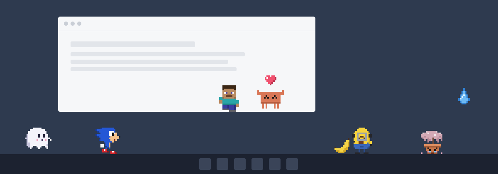
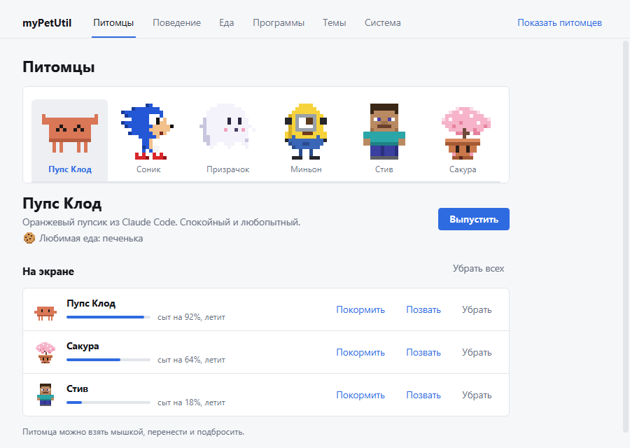
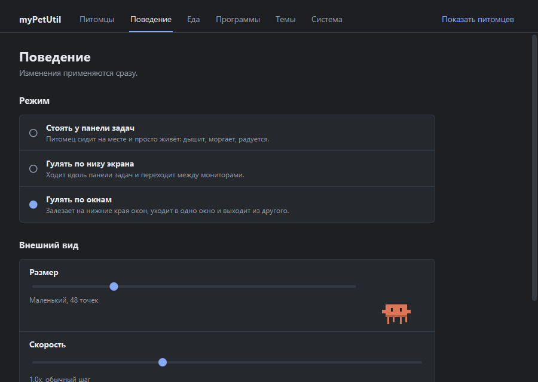
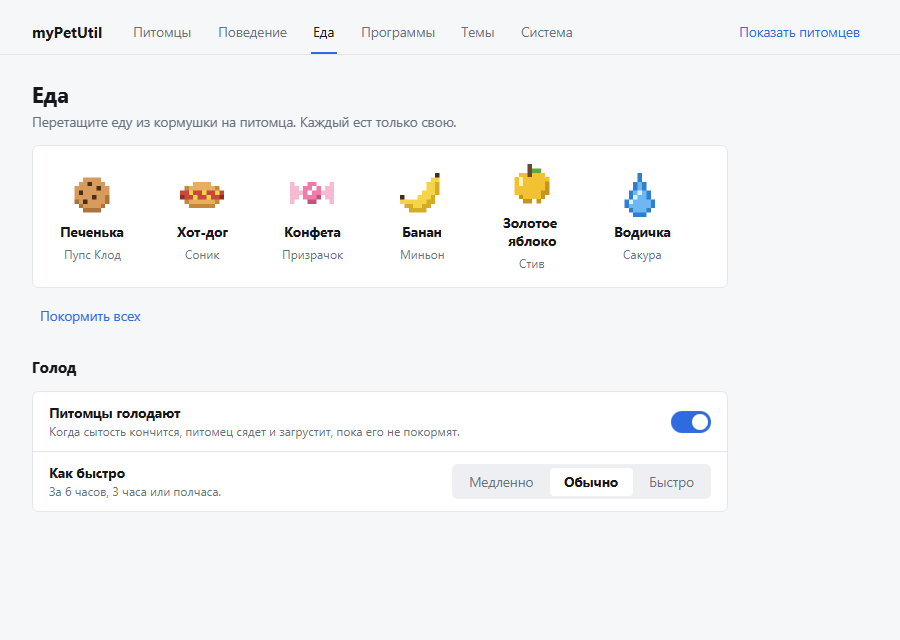
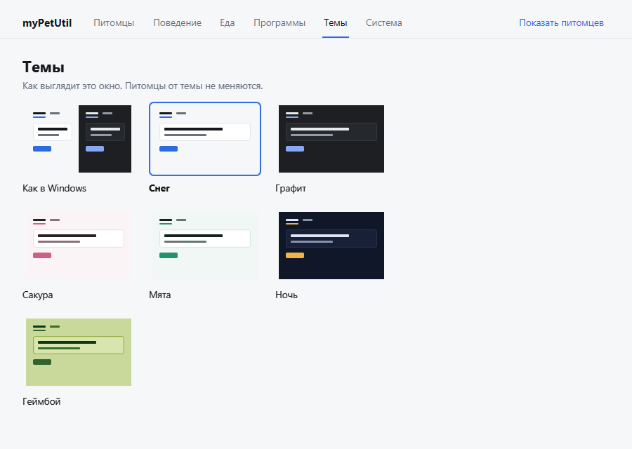
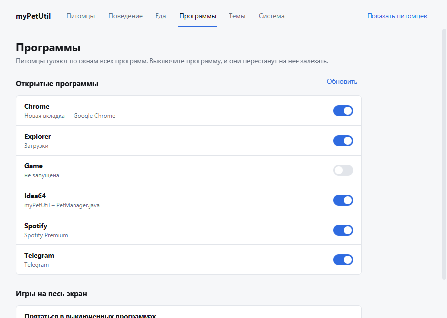
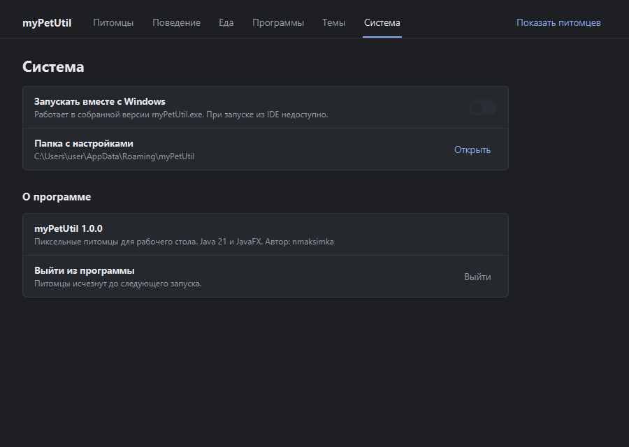

# myPetUtil

Пиксельные питомцы для рабочего стола Windows. Они гуляют по панели задач и по нижним краям окон,
заходят в одно окно и выходят из другого, переходят между мониторами, едят, радуются и грустят.
Питомца можно взять мышкой, перенести и подбросить: он упадёт с гравитацией и приземлится на ближайшее окно
или на панель задач.



## Персонажи

| Персонаж | Любимая еда | Особенность |
|---|---|---|
| Пупс Клод | Печенька | Оранжевый пупсик из Claude Code |
| Соник | Хот-дог | Ходит быстрее всех |
| Призрачок | Конфета | Не касается земли, падает медленно, как пёрышко |
| Миньон | Банан | Одно большое очко и комбинезон |
| Стив | Золотое яблоко | Кубический, нарисован анфас |
| Сакура | Водичка | Деревце в горшочке, глазки на горшке; когда грустит — роняет лепестки |

У каждого есть анимации: стоит и дышит, моргает, идёт, радуется при наведении мыши, болтает ногами,
когда его несут, приземляется, ест, сидит и плачет, когда голодный.

## Возможности

- **Три режима поведения**
  - стоять у панели задач и просто жить на месте;
  - гулять по низу экрана и переходить между мониторами;
  - гулять по окнам: питомец залезает на нижние края окон, уходит за край одного окна и выходит из другого.
- **Несколько мониторов.** Питомец уходит за край одного монитора и выходит с любой стороны другого.
  Масштаб 125%, 150% и разный масштаб на разных мониторах учитывается.
- **Полноэкранные программы.** В играх и видео на весь экран питомцы ходят по самому низу монитора.
  Если программа выключена в настройках, питомцы на это время прячутся.
- **Выбор программ.** На вкладке «Программы» можно запретить гулять по окнам любой программы.
- **Кормление.** Еду из кормушки перетаскивают прямо на питомца. Каждый ест только свою, на чужую удивляется.
  Если уронить еду рядом, питомец сам к ней подойдёт.
- **Сытость (по желанию).** Если включить, питомцы со временем голодают, а когда сытость кончится —
  садятся и грустят, пока их не покормят. Скорость: 6 часов, 3 часа или полчаса.
- **Сколько угодно питомцев** одновременно, хоть весь экран.
- **Размер и скорость** настраиваются.
- **Темы окна настроек:** Как в Windows, Снег, Графит, Сакура, Мята, Ночь, Геймбой.
- **Значок в трее** (у часов): открыть настройки, выпустить питомца, покормить всех, спрятать, выйти.
- **Автозапуск с Windows** — выключен по умолчанию, включается в настройках.
- Питомцы не появляются на панели задач и в Alt+Tab и не забирают фокус у окна, по которому гуляют.

## Скриншоты

| | |
|---|---|
|  |  |
| Вкладка «Питомцы»: все стоят на полке, кликом выбирается, кого выпустить | Режимы, размер и скорость (тема «Графит») |
|  |  |
| Кормушка: еду тащат мышкой на питомца | Выбор темы |
|  |  |
| По окнам каких программ можно гулять | Автозапуск, папка с настройками, выход |

## Управление

| Действие | Что происходит |
|---|---|
| Навести мышь | Питомец радуется, над головой сердечко, при включённой сытости видна полоска |
| Зажать и тащить | Питомец болтается в руке и наклоняется в сторону движения |
| Отпустить с размаху | Летит, отскакивает от краёв экрана и приземляется на окно или панель задач |
| Перетащить еду на питомца | Ест, если это его еда; если чужая — над головой знак вопроса |
| Двойной клик по значку в трее | Открывает настройки |

Закрытие окна настроек не выключает программу: она остаётся в трее. Выйти — через трей или вкладку «Система».

## Запуск

### Готовый exe

1. Скачайте архив `myPetUtil-<версия>-windows.zip` со страницы [Releases](https://github.com/nmaksimka/myPetUtil/releases) и распакуйте в любую папку.
2. Запустите `myPetUtil.exe`. Java ставить не нужно, она уже внутри.

exe не подписан платным сертификатом, поэтому при первом запуске Windows может показать окно
«Windows защитила ваш компьютер». Нажмите «Подробнее» → «Выполнить в любом случае».

### Из исходников

Нужна JDK 21.

```bash
./gradlew run          # запустить
./gradlew test         # тесты
./gradlew zipExe       # собрать build/dist/myPetUtil-<версия>-windows.zip с exe внутри
```

В IntelliJ IDEA проект открывается как Gradle-проект, запускать можно задачу `run`
или класс `io.github.nmaksimka.mypetutil.Launcher`.

## Где хранятся настройки

`%APPDATA%\myPetUtil\settings.json` — режим, размер, тема, запрещённые программы, список питомцев
и их сытость. Файл можно удалить, тогда программа начнёт с чистого листа с одним пупсом.

## Как это устроено

```
io.github.nmaksimka.mypetutil
├── sprite     пиксельная графика: сетка 16x16, персонажи и еда рисуются кодом по пикселям
├── world      «мир»: мониторы и полы, по которым можно ходить (низ экрана, нижние края окон)
├── pet        логика питомца без JavaFX: состояния, ходьба, гравитация, переходы, еда, голод
├── platform   Windows через JNA: список окон, их программы, мониторы, автозапуск, тема системы
├── overlay    прозрачные окна поверх всех, игровой цикл, перетаскивание мышью
├── ui         окно настроек, вкладки, темы, трей
└── config     настройки и сохранение в JSON
```

- **Окна и мониторы.** Раз в 300 мс фоновый поток спрашивает у Windows список окон
  (`EnumWindows`, `DwmGetWindowAttribute`) и мониторов. Видимые границы окна берутся без невидимой тени
  Windows 10/11, свёрнутые, скрытые и системные окна отбрасываются.
- **Полы.** Нижний край каждого окна становится полом. Если низ окна закрыт другим окном,
  закрытый кусок вырезается — питомец не ходит там, где его не видно.
- **Масштаб экрана.** Windows отдаёт физические пиксели, JavaFX работает в логических точках.
  Каждый монитор пересчитывается отдельно, поэтому работает и с разным масштабом на разных мониторах.
- **Питомец** — конечный автомат: стоит, идёт, уходит за край, выходит из-за края, летит, приземляется,
  ест, радуется, грустит. Логика не зависит от JavaFX и покрыта тестами.
- **Отрисовка.** Каждый питомец — маленькое прозрачное окно поверх всех. Прозрачные пиксели пропускают клики
  насквозь, поэтому питомец не мешает работать. Спрайты увеличиваются без размытия.
- **exe** собирается `jpackage` из JDK 21 со встроенной урезанной Java.

## Сколько ресурсов ест

Замеры на Windows 11, 20 ядер, 5 питомцев, версия 1.0.1 по сравнению с 1.0.0:

| | 1.0.0 | 1.0.1 |
|---|---|---|
| Процессор, питомцы гуляют | ~17% одного ядра | ~14% одного ядра (0,7% всего компьютера) |
| Процессор, открыто окно настроек | ~54% одного ядра | ~19% одного ядра |
| Память | ~230 МБ | ~155 МБ |
| Размер на диске / архив | 163 / 64 МБ | 59 / 44 МБ |

Что сделано в 1.0.1:
- питомец и превью в настройках перерисовываются только когда меняется кадр, а не 60 раз в секунду;
- окна питомцев двигаются напрямую через WinAPI (`SetWindowPos`), без перерисовки JavaFX,
  а сам питомец ходит шагами по одному пикселю спрайта;
- в exe кладутся только 5 нужных модулей Java из ~70 (проверено `jdeps`), куча ограничена 96 МБ,
  простой сборщик мусора и 2 потока JIT-компилятора вместо 8–10.

Основная оставшаяся цена — прозрачные окна JavaFX: каждый новый кадр копируется из видеокарты в окно Windows.

## Тесты

```bash
./gradlew test
```

Покрыты сохранение настроек, построение полов из окон (в том числе перекрытые окна и полноэкранный режим),
пересчёт координат при масштабе 150% и на двух мониторах, поведение питомца: падение, ходьба,
переход на другой монитор, падение при закрытии окна, движение вместе с окном, голод и еда.

Для разработки есть вспомогательные задачи: `exportSprites` (все кадры всех персонажей в одной картинке),
`uiScreenshots` (скриншоты окна настроек), `dumpWindows` (какие окна видит программа).

## Стек

Java 21, JavaFX 21, Gradle, JNA, Gson, JUnit 5.

---

Некоммерческий фанатский проект для себя и друзей. Персонажи принадлежат их правообладателям,
все спрайты нарисованы заново в пиксель-арте.
